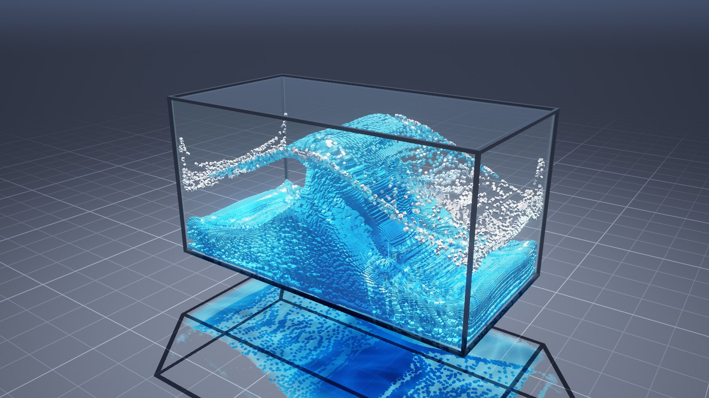

# Water Sim
A sandbox fluid physics simulation

A big box (container) partly filled with water. The user can add forces to the box so that the water splashes and generates waves.

The box and water are visualized in real time in 3D.

The main feature of this sim is that the water is modeled and visualized as many small cubes.



Tens of thousands to hundreds of thousands of tiny cubes, simulated live on your GPU with WebGPU. Grab the tank and shake it, tilt it, fire a wave machine, splash, stir, pour, drain or drop a ball in. It's a standalone static web app with no build step and no dependencies, so it runs straight from GitHub Pages.

## Features

**Tools** (number keys 1–8)

| Tool | What it does |
| --- | --- |
| Push | Drag through the water to shove it around |
| Splash | Click for a blast with a crater and spray; hold to keep blasting |
| Vortex | Spin up a whirlpool |
| Magnet | Pull water into a blob (hold Shift to repel). Great in zero-G |
| Pour | Pour a stream of new water in from above |
| Drain | Suck water out of the tank |
| Ball | Drag or throw a ball. Let go and it falls, splashes and floats |
| Shake | Grab the tank itself and shake it; it springs back and the water sloshes |

**Physics**
- MLS-MPM fluid simulation running entirely in WebGPU compute shaders
- The water is simulated in the tank's frame, so shaking, tilting and earthquakes become real inertial forces (linear, Euler, centrifugal and Coriolis)
- Wave machine paddle, tank tilt (sliders, arrow keys or the phone's tilt sensor), rocking motion and an earthquake button
- Adjustable gravity (including zero-G), viscosity from water to honey, incompressibility and time scale
- Eight scenes: Dam Break, Clash, Big Drop, Calm Pool, Wave Tank, Tower, Zero-G and Layer Cake

**Visuals**
- Every particle is a cube. Only the three faces facing the camera are generated, and cubes tumble with the local vorticity of the flow, then settle back into a neat voxel grid when the water calms down
- Light absorption through the water body (a shadow map storing the water's front and back depth), so deep water turns blue
- Caustics on the floor and underwater, foam and spray on impacts, sun glints and Fresnel reflections on the surface
- Glass tank, HDR rendering with 4× MSAA, bloom, ACES tonemapping and vignette
- Water styles: Ocean, Lagoon, Glacier, Lava, Toxic and Ink. Colour modes: water, dye (watch the colours mix) and speed. Lighting: Studio, Daylight, Sunset and Midnight

**Performance**
- On first load the app calibrates itself on your GPU and picks a quality preset, from 28k cubes (Low) up to about 400k (Extreme)
- Adaptive resolution steps in if the frame rate drops, and a GPU timing panel breaks down where the time goes
- On a laptop with an integrated AMD Radeon 890M it runs the High preset (about 130k–170k cubes) at 60 fps

**Also:** screenshot (P), video clip recording (K), fullscreen, touch controls, a help overlay (H) and keyboard shortcuts for everything.

## Controls

| Input | Action |
| --- | --- |
| Left-drag on the tank | Use the current tool |
| Left-drag outside the tank, or right-drag | Orbit the camera |
| Shift + right-drag, or middle-drag | Pan |
| Scroll / pinch | Zoom |
| `Space` / `.` | Pause / step one frame |
| `R` / `N` | Restart scene / next scene |
| Arrow keys | Tilt the tank (hold) |
| `E` / `M` / `G` | Earthquake / wave machine / zero gravity |
| `C` / `V` | Cycle water style / colour mode |
| `P` / `K` / `F` / `U` | Screenshot / record video / fullscreen / hide interface |

## Running locally

Any static file server works. ES modules don't load from `file://`, so you do need a server. With Node.js:

```bash
npm run dev
```

Then open <http://localhost:5173>. Alternatively, run `python -m http.server` in the repository root.

## Deploying to GitHub Pages

The repository root is the site, so either option works:

1. **GitHub Actions (included).** In the repository's *Settings → Pages*, set *Source* to **GitHub Actions**. The workflow in `.github/workflows/pages.yml` publishes the app on every push to `main`.
2. **Deploy from a branch.** Set *Source* to **Deploy from a branch** and choose `main` / `(root)`. In that case you can delete the workflow file.

## Browser support

WebGPU is required. That means Chrome or Edge 113+, Safari 26+ (macOS, iOS and iPadOS), or Firefox 141+ on Windows. Browsers without WebGPU get a friendly explanation instead of a blank page.

## How it works

- **Simulation** (`src/sim`): MLS-MPM, the moving least squares material point method, with an equation of state for weakly compressible water. Each substep does the following:
  1. Particles are binned into 4×4×4-cell blocks with a counting sort.
  2. Particle→grid transfer accumulates into a shared-memory tile per block. Fixed-point atomics are used because WGSL has no float atomics.
  3. The grid update applies gravity, the tank's inertial forces, tools, the ball, the paddle and the walls.
  4. Grid→particle transfer gathers velocity and the APIC affine matrix, then advects the particles.

  Near the walls the density estimate uses mirror-image "ghost" mass so water doesn't pile up against the glass, and an artificial bulk viscosity damps compression waves. The particle count lives on the GPU, so pouring and draining use indirect dispatch and draws.
- **Rendering** (`src/render`): instanced cubes read straight from the simulation's instance buffer. A light-space pass stores the water's front and back depth with min/max blending, which gives physically motivated light absorption (Beer–Lambert) for the water, its shadow and the caustics on the floor. A height map of the water surface supplies depth-dependent skylight and gates reflections to cubes actually at the surface.
- **App and UI** (`src/app.js`, `src/ui`): an orbit camera with lens shift (the tank stays centred next to the side panel), tank rigid-body dynamics, pointer tools with GPU picking, and a dependency-free DOM UI.

```
index.html          entry page (intro and fallback screens)
src/main.js         WebGPU setup, quality calibration, error handling
src/app.js          frame loop, tools, unit conversions, uniforms
src/sim/            MPM solver (shaders.js), driver (fluid.js), scene seeding
src/render/         renderer and WGSL for cubes, shadows, floor, glass, post
src/ui/             interface, icons and styles
tools/              dev server, headless benchmark and scripted browser driver
```

## Development tools

- `npm run dev`: a zero-dependency static server.
- `npm run check`: a headless Chrome smoke test. It fails on console errors, NaNs or a frame rate under 30 fps.
- `node tools/bench.mjs --seconds 5 --shot out.png`: GPU timings and frame rate for the default scene.
- `node tools/drive.mjs steps.json`: scripted clicks, drags, keys and screenshots for interaction testing.

The headless tools drive a local Chrome over the DevTools protocol. Set `CHROME` to point at a different browser binary.
